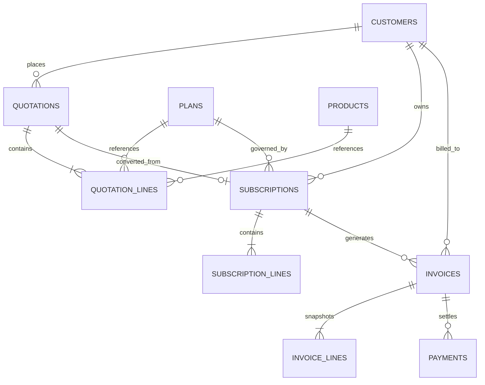
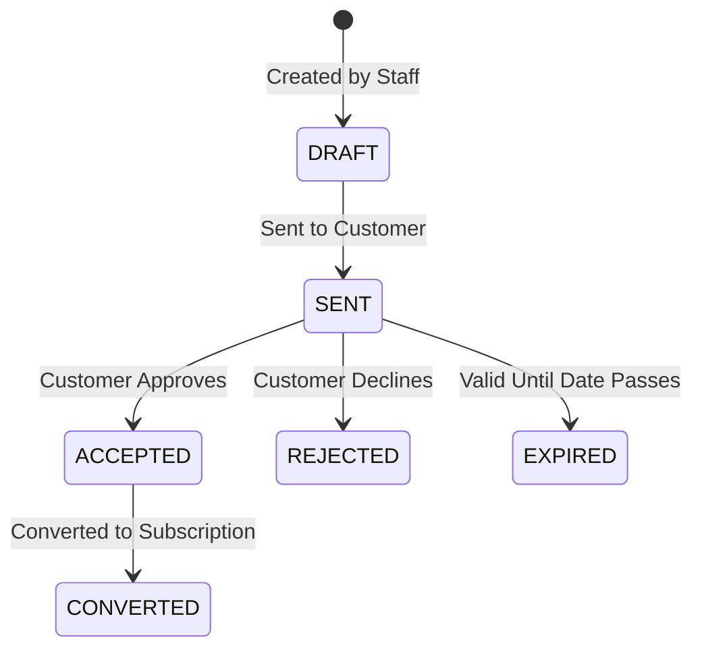
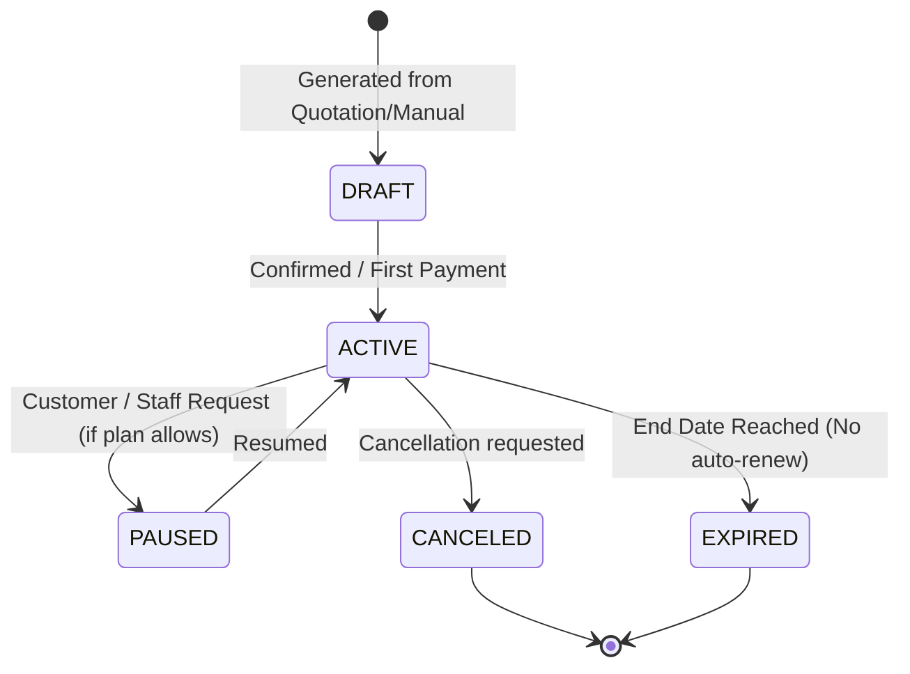
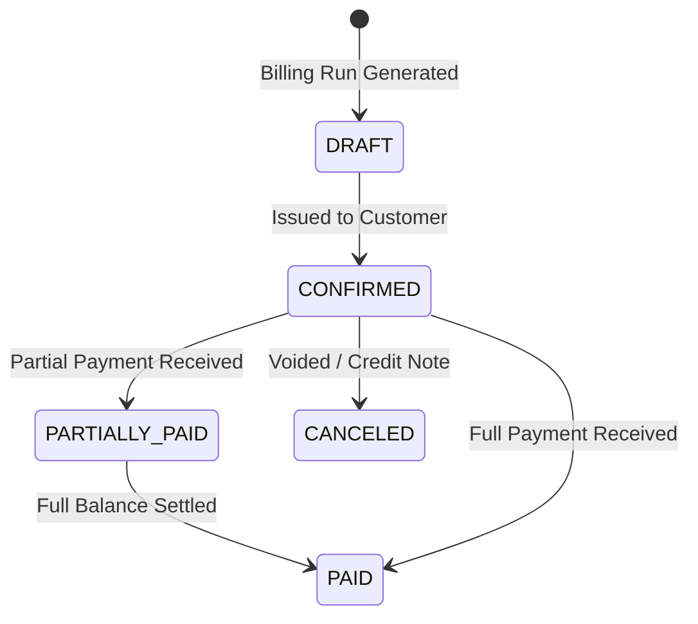

# Member 3: Quotations, Subscriptions, and Billing Foundation Specification

## 1. Domain Overview & Objectives

As Member 3, your mission is to build the core transactional engine of **Brightloop Software**:
1. **Quotations Workflow**: Capturing customer interest into price-locked, expiring proposals (`Draft` → `Sent` → `Accepted` / `Rejected` / `Expired`).
2. **Subscription Lifecycle**: Converting accepted quotations into active subscriptions and managing their lifecycle (`Active`, `Paused`, `Canceled`, `Expired`).
3. **Recurring Billing & Invoicing**: Automated and manual calculation of billing periods, generating idempotent invoices with line-item snapshots.
4. **Financial Accuracy & Tax Engine**: Precision decimal arithmetic (`NUMERIC(12, 2)` / Python `Decimal`) calculating subtotals, tax rates, discounts, and net balances.
5. **Payment Recording**: Tracking transactions (partial or full payments), balancing invoice amounts, and maintaining complete audit trails.

---

## 2. Core Architectural Principles (Phase 1 Foundation)

### 2.1. SQLAlchemy 2.x Relationships & Cascades

The billing domain requires strict relational integrity with foreign keys, compound constraints, and explicit loading strategies:



#### Key Relational Rules:
- **Immutable Snapshots**: A quotation or invoice line must never simply point to a live `product.sales_price` or `plan.price`. If a price changes tomorrow in Member 2's catalog, historical quotations and invoices must not change.
  - `quotation_lines` and `invoice_lines` store frozen snapshots of: `item_name`, `unit_price`, `quantity`, `tax_rate`, `tax_amount`, and `discount_amount`.
- **Eager Loading Strategy**: Use `selectinload` or `joinedload` for parent-to-child collections (e.g. `Quotation.lines`, `Subscription.lines`, `Invoice.lines`, `Invoice.payments`) to eliminate N+1 query bottlenecks in API endpoints and background billing workers.
- **Cascades & Deletion Policies**:
  - `cascade="all, delete-orphan"` for Quotation -> QuotationLines and Invoice -> InvoiceLines when a draft is deleted.
  - Invoices and active Subscriptions must never be hard-deleted if payments or audit histories exist. Use soft status transitions (`status = 'canceled'` or `status = 'closed'`).

---

### 2.2. Database Transactions & ACID Boundaries

Financial operations require atomic transaction boundaries. If any step fails, the entire transaction rolls back:

1. **Quotation Conversion Transaction**:
   - Verify quotation status is `ACCEPTED` and not `EXPIRED`.
   - Verify no existing subscription is already linked to this `quotation_id` (Idempotent check).
   - Create `Subscription` record with `status = 'ACTIVE'`, calculating `start_date` and `next_billing_date`.
   - Copy `QuotationLines` into `SubscriptionLines`.
   - Update `Quotation` status to `CONVERTED`.
   - Commit atomically.

2. **Billing Run Transaction**:
   - Target subscriptions where `status = 'ACTIVE'` and `next_billing_date <= run_date`.
   - Acquire row locks (`with_for_update`) if operating in concurrent multi-worker environments.
   - For each eligible subscription:
     - Compute `billing_period_start` and `billing_period_end`.
     - Insert `Invoice` and `InvoiceLines` inside a savepoint / transaction.
     - Advance subscription `next_billing_date` by the billing interval.
     - Enforce the PostgreSQL unique constraint: `UNIQUE (subscription_id, billing_period_start, billing_period_end)`.
     - Commit per subscription or batch with rollback on individual failure to isolate errors.

3. **Payment Settlement Transaction**:
   - Lock invoice row (`with_for_update`).
   - Insert `Payment` record with amount and reference.
   - Recompute total paid: $\text{Total Paid} = \sum(\text{Successful Payments})$.
   - If $\text{Total Paid} \ge \text{Invoice Total Amount}$, set `invoice.status = 'PAID'`.
   - If $0 < \text{Total Paid} < \text{Invoice Total Amount}$, set `invoice.status = 'PARTIALLY_PAID'`.
   - Commit atomically.

---

### 2.3. FastAPI Service Layers & Layer Separation

To ensure testability and prevent business logic leaks into HTTP handlers:

```text
[ HTTP Request ]
       |
       v
[ Router: app/api/v1/endpoints/ ]   <-- Thin HTTP adapters: parse parameters, validate schema, inject dependencies
       |
       v
[ Auth Dependency: core/security.py ] <-- Verify JWT token, extract CurrentUser, enforce RBAC
       |
       v
[ Service Layer: app/services/ ]     <-- Pure business logic, calculations, transaction control
       |
       v
[ ORM Models: app/models/ ]          <-- SQLAlchemy 2.0 mapped models
       |
       v
[ PostgreSQL Database ]
```

- **Background Workers (`app/workers/billing_worker.py`)**: Scheduled cron or interval tasks invoke `BillingService.process_recurring_billing(db_session, run_date)` directly, reusing the exact same service code called by the Admin API endpoint `POST /api/v1/billing/run`.

---

### 2.4. Date, Billing Period, and Recurrence Calculations

All dates and timestamps must be timezone-aware UTC (`datetime.now(timezone.utc)`).

#### Billing Interval Definitions:
- **`daily`**: $\text{Next Date} = \text{Current Date} + 1\text{ day}$
- **`weekly`**: $\text{Next Date} = \text{Current Date} + 7\text{ days}$
- **`monthly`**: $\text{Next Date} = \text{Current Date} + 1\text{ calendar month}$
- **`yearly`**: $\text{Next Date} = \text{Current Date} + 1\text{ calendar year}$

#### Month-End Date Drift (Safe Calendar Math):
In financial recurring subscriptions, adding a month to January 31 must resolve to February 28 (or 29 in leap years), not roll into March.
- Use Python's `dateutil.relativedelta`:
  ```python
  from dateutil.relativedelta import relativedelta
  from datetime import datetime, timezone

  def calculate_next_billing_date(current_billing_date: datetime, frequency: str) -> datetime:
      if frequency == "daily":
          return current_billing_date + relativedelta(days=1)
      elif frequency == "weekly":
          return current_billing_date + relativedelta(weeks=1)
      elif frequency == "monthly":
          return current_billing_date + relativedelta(months=1)
      elif frequency == "yearly":
          return current_billing_date + relativedelta(years=1)
      raise ValueError(f"Unsupported frequency: {frequency}")
  ```

#### Period Boundaries:
For a monthly billing cycle starting `2026-11-01 00:00:00 UTC`:
- `billing_period_start = 2026-11-01 00:00:00`
- `billing_period_end = 2026-11-30 23:59:59`
- `next_billing_date = 2026-12-01 00:00:00`

---

### 2.5. Financial Calculations & Decimal Arithmetic

> [!CAUTION]
> **Zero Floating-Point Tolerance**: Never use Python `float` or SQL `FLOAT`/`REAL` for monetary amounts. Binary floating-point errors (e.g. `0.1 + 0.2 = 0.30000000000000004`) lead to tax and reconciliation discrepancies.

#### Rules for Monetary Arithmetic:
1. Always use Python's `Decimal` type from the `decimal` module.
2. Store monetary fields in PostgreSQL as `NUMERIC(12, 2)` (supporting amounts up to 9,999,999,999.99 INR).
3. Explicitly quantize all calculated amounts using `ROUND_HALF_UP`:
   ```python
   from decimal import Decimal, ROUND_HALF_UP

   TWOPLACES = Decimal('0.01')

   def quantize_money(amount: Decimal) -> Decimal:
       return amount.quantize(TWOPLACES, rounding=ROUND_HALF_UP)
   ```
4. **Formulas**:
   $$\text{Line Subtotal} = \text{quantize}(\text{unit\_price} \times \text{quantity})$$
   $$\text{Line Discount} = \text{quantize}(\text{Line Subtotal} \times (\text{discount\_pct} / 100))$$
   $$\text{Taxable Amount} = \text{Line Subtotal} - \text{Line Discount}$$
   $$\text{Line Tax} = \text{quantize}(\text{Taxable Amount} \times (\text{tax\_rate\_pct} / 100))$$
   $$\text{Line Total} = \text{Taxable Amount} + \text{Line Tax}$$
   $$\text{Invoice Total} = \sum \text{Line Totals}$$

5. Currency standard across the application is `INR` (Indian Rupee), formatted in JSON responses as decimal strings (e.g. `"2500.00"`).

---

### 2.6. Billing Idempotency & Concurrency Safety

Recurring billing workers or admin manual triggers can execute simultaneously or experience network timeouts. To prevent duplicate billing:

1. **Database-Level Compound Unique Index**:
   ```sql
   CREATE UNIQUE INDEX uq_invoice_subscription_period 
   ON invoices (subscription_id, billing_period_start, billing_period_end)
   WHERE status != 'CANCELED';
   ```
2. **Application-Level Idempotency Check**:
   Before generating an invoice, the `BillingService` queries:
   ```python
   stmt = select(Invoice).where(
       Invoice.subscription_id == subscription.id,
       Invoice.billing_period_start == period_start,
       Invoice.billing_period_end == period_end,
       Invoice.status != "CANCELED"
   )
   existing_invoice = db.scalars(stmt).first()
   if existing_invoice:
       logger.info("Invoice already exists for this period. Skipping.")
       return existing_invoice
   ```
3. **Quotation-to-Subscription Idempotency**:
   The `subscriptions` table has a `UNIQUE(quotation_id)` constraint where `quotation_id IS NOT NULL` to prevent converting the same quotation multiple times.

---

### 2.7. REST API Design & Lifecycle State Machines

#### Quotation State Transitions:


#### Subscription State Transitions:


#### Invoice State Transitions:


---

## 3. Schema Review & Alignment with Member 2 (Products & Plans)

Member 3's models directly consume catalog data produced by Member 2. We verify the following integration contracts:

1. **Products (`products`)**:
   - `id`: UUID primary key.
   - `name`: String, product title (e.g. "Brightloop ERP").
   - `sales_price`: `NUMERIC(12, 2)`, base sales price.
   - `currency`: String (default `"INR"`).
   - `is_active`: Boolean.

2. **Product Variants (`product_variants`)**:
   - `id`: UUID primary key.
   - `product_id`: FK to `products.id`.
   - `name`: Variant title (e.g. "Cloud Edition").
   - `price`: `NUMERIC(12, 2)`, additional or override price.

3. **Subscription Plans (`subscription_plans` / `plans`)**:
   - `id`: UUID primary key.
   - `name`: Plan title (e.g. "Enterprise Annual").
   - `price`: `NUMERIC(12, 2)`, baseline plan fee.
   - `billing_interval` / `billing_frequency`: Enum or validated string (`"daily"`, `"weekly"`, `"monthly"`, `"yearly"`).
   - Policy Flags:
     - `allow_pause` (Boolean): Determines whether `POST /api/v1/subscriptions/{id}/pause` is permitted.
     - `allow_early_cancellation` (Boolean): Determines whether early termination is allowed without penalty.
     - `allow_renewal` (Boolean): Governs automated renewal beyond initial term.
     - `auto_close` (Boolean): Automatically sets subscription to `EXPIRED` if not renewed.
   - Relationships:
     - `plan_products`: Many-to-many relationship linking bundled products and default quantities.

4. **Pricing Semantics Agreement**:
   - Total base price for a quotation line = $(\text{Plan/Product Price} + \text{Variant Additional Price}) \times \text{Quantity}$.
   - All amounts are exclusive of tax unless explicitly marked in the quotation agreement.

---

## 4. Phase 1 Checklist & Definition of Readiness for Phase 2

- [x] Verified database entity definitions and foreign keys for Member 3 (`quotations`, `quotation_lines`, `subscriptions`, `subscription_lines`, `invoices`, `invoice_lines`, `payments`).
- [x] Defined decimal precision rules and rounding strategies (`NUMERIC(12, 2)` + `ROUND_HALF_UP`).
- [x] Established state transition rules for Quotations, Subscriptions, and Invoices.
- [x] Formulated calendar math and safe recurrence calculations using `dateutil.relativedelta`.
- [x] Designed database and application-level idempotency strategy for recurring billing.
- [x] Reviewed and verified schema contract with Member 2 (Products, Variants, and Plans).
- [x] Confirmed alignment with shared architecture guidelines in `docs/BRIGHTLOOP_MASTER_AI_INSTRUCTIONS.md`.
